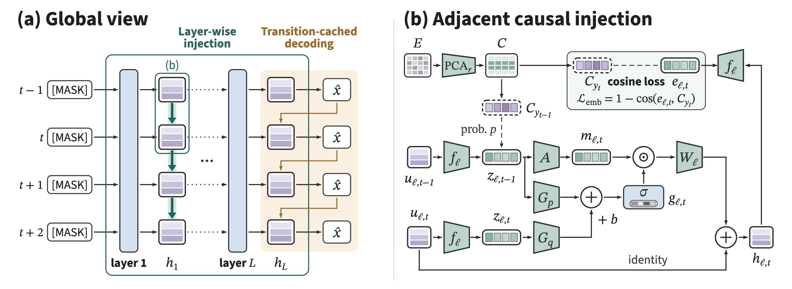

<h1 align="center">DSpine</h1>

<p align="center">
  <b>Draft in Parallel, Condition Through Depth: Adjacent Causal Injection for Speculative Decoding</b>
</p>

<p align="center">
  <a href="https://arxiv.org/abs/2609.36173"></a>
  <a href="https://dspine-project.github.io"></a>
  <a href="https://huggingface.co/collections/tencent/dspine"></a>
  
</p>

DSpine is a parallel drafter for speculative decoding. At every draft layer, each position receives the predicted
feature of its predecessor, so the causal chain unfolds over network depth while all positions are still drafted in
parallel.

<p align="center">
  
</p>

## News

- **[2026-10]** Inference code and model weights released.
- **[2026-09]** Paper released on [arXiv](https://arxiv.org/abs/2609.36173).

## Supported Models

| Target model | Draft model |
| --- | --- |
| `Qwen3-8B` | [tencent/Qwen3-8B-DSpine-b16](https://huggingface.co/tencent/Qwen3-8B-DSpine-b16) |
| `Qwen3.8-27B` | Coming soon |

## Results

Acceptance length on Qwen3-8B. DSpine, DSpark and DFlash2 are all retrained on
[Open-PerfectBlend](https://huggingface.co/datasets/mlabonne/open-perfectblend) with the same configuration.

| Temp. | Method | GSM8K | MATH-500 | HumanEval | MBPP | LCB | MT-Bench | Arena-Hard | Avg. |
|---|---|:---:|:---:|:---:|:---:|:---:|:---:|:---:|:---:|
| T = 0 | DFlash<sup>†</sup> | 6.32 | 7.99 | 6.56 | 6.29 | 6.11 | 4.26 | 3.91 | 5.92 |
|  | Domino<sup>†</sup> | 9.68 | 9.40 | 7.23 | 6.89 | 6.40 | 5.12 | 4.65 | 7.05 |
|  | DSpark | 10.00 | 9.88 | 7.78 | 7.35 | 6.81 | 5.39 | 4.87 | 7.44 |
|  | DFlash2 | 10.06 | 10.04 | 7.99 | 7.33 | 6.96 | 5.40 | 5.06 | 7.55 |
|  | **DSpine** | **10.55** | **10.30** | **8.27** | **7.66** | **7.25** | **5.63** | **5.13** | **7.83** |
| T = 1 | DFlash<sup>†</sup> | 5.75 | 6.51 | 5.52 | 5.23 | 4.53 | 3.77 | 3.25 | 4.94 |
|  | Domino<sup>†</sup> | 8.01 | 7.13 | 5.89 | 5.56 | 4.59 | 4.36 | 3.61 | 5.59 |
|  | DSpark | 9.33 | 8.64 | 6.91 | 6.66 | 5.78 | 4.99 | 4.25 | 6.65 |
|  | DFlash2 | 9.07 | 8.42 | 6.99 | 6.43 | 5.67 | 4.90 | 4.25 | 6.53 |
|  | **DSpine** | **9.83** | **8.99** | **7.39** | **6.97** | **6.11** | **5.09** | **4.49** | **6.98** |

<sup>†</sup> Official checkpoints: [z-lab/Qwen3-8B-DFlash-b16](https://huggingface.co/z-lab/Qwen3-8B-DFlash-b16) and
[Huang2020/Qwen3-8B-Domino-b16](https://huggingface.co/Huang2020/Qwen3-8B-Domino-b16).

## Installation

Use Python 3.10 or later with CUDA. The command below installs DSpine and SGLang 0.5.20.

```bash
git clone https://github.com/tencent/dspine.git
cd dspine
python -m pip install -e .
```

## Usage

The following example serves a DSpine draft with Qwen3-8B using the
[tencent/Qwen3-8B-DSpine-b16](https://huggingface.co/tencent/Qwen3-8B-DSpine-b16) checkpoint.

```bash
sglang serve \
  --model-path Qwen/Qwen3-8B \
  --speculative-algorithm DSPINE \
  --speculative-draft-model-path tencent/Qwen3-8B-DSpine-b16 \
  --speculative-num-draft-tokens 16 \
  --tp-size 1 \
  --dtype bfloat16 \
  --attention-backend fa3 \
  --page-size 1 \
  --mem-fraction-static 0.65 \
  --context-length 8192 \
  --max-running-requests 64 \
  --cuda-graph-bs-decode 1 2 4 8 16 32 64 \
  --trust-remote-code
```

## Roadmap

- [ ] Training code for DSpine
- [ ] DSpine for Qwen3.8-27B

## Acknowledgements

We thank [DFlash](https://github.com/z-lab/dflash), [SpecForge](https://github.com/sgl-project/SpecForge),
[SGLang](https://github.com/sgl-project/sglang) and [FlashInfer](https://github.com/flashinfer-ai/flashinfer)
for their open-source work.

## Citation

```bibtex
@article{zhang2026dspine,
  title   = {Draft in Parallel, Condition Through Depth: Adjacent Causal Injection for Speculative Decoding},
  author  = {Zhang, Haohui and Chen, Keyu and Sun, Haocheng and Gu, Weibo and Qiao, Ruizhi and Sun, Xing and Jiang, Bo},
  journal = {arXiv preprint arXiv:2609.36173},
  year    = {2026}
}
```

## License

[Apache 2.0](https://github.com/Tencent/DSpine/blob/main/License.txt)
