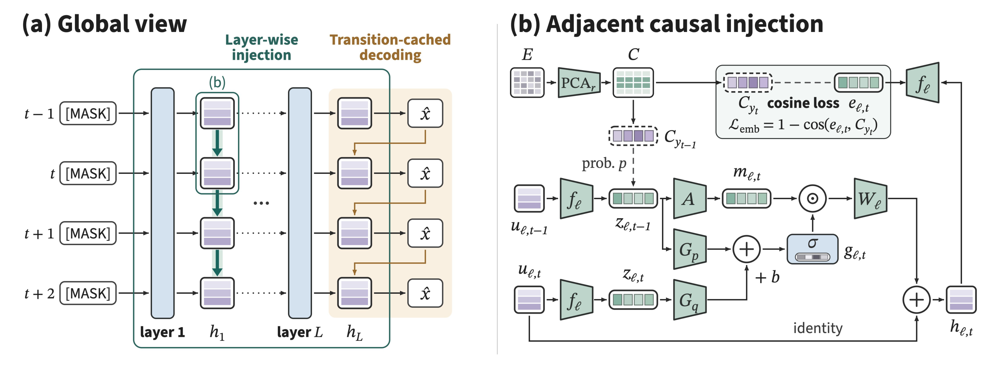

<h1 align="center">DSpine</h1>

<p align="center">
  <b>Draft in Parallel, Condition Through Depth: Adjacent Causal Injection for Speculative Decoding</b>
</p>

<p align="center">
  <a href="https://arxiv.org/abs/2609.36173"></a>
  <a href="https://dspine-project.github.io"></a>
  <a href="https://huggingface.co/collections/tencent/dspine"></a>
  
</p>

DSpine is a parallel drafter for speculative decoding. Each draft layer passes the
predicted feature of each position to the next, allowing token dependencies to be
modeled during parallel drafting.

<p align="center">
  
</p>

## News

- **[2026-11]** Added support for Qwen3.8-27B inference.
- **[2026-11]** 🍎 Added support for Apple Silicon inference via mlx-lm and SGLang-MLX.
- **[2026-10]** 🚀 [Training code](https://github.com/sgl-project/SpecForge/pull/1038) released in SpecForge.
- **[2026-10]** 🤗 [Qwen3-8B draft weights](https://huggingface.co/tencent/Qwen3-8B-DSpine-b16) released.
- **[2026-10]** 💻 [Inference code](https://github.com/tencent/dspine) released.
- **[2026-10]** 📄 [Paper](https://arxiv.org/abs/2609.36173) released on arXiv.

## Supported Models

| Target model | Draft model |
| --- | --- |
| `Qwen3-8B` | [tencent/Qwen3-8B-DSpine-b16](https://huggingface.co/tencent/Qwen3-8B-DSpine-b16) |
| `Qwen3.8-27B` | [tencent/Qwen3.8-27B-DSpine-b16](https://huggingface.co/tencent/Qwen3.8-27B-DSpine-b16) |

## Results

### Qwen3-8B

Acceptance length on Qwen3-8B. DSpine, DSpark and DFlash2 are trained on the same
[Open-PerfectBlend](https://huggingface.co/datasets/mlabonne/open-perfectblend) data with the same training budget.

| Temp. | Method | GSM8K | MATH-500 | HumanEval | MBPP | LCB | MT-Bench | Arena-Hard | Avg. |
|---|---|:---:|:---:|:---:|:---:|:---:|:---:|:---:|:---:|
| T = 0 | DFlash<sup>†</sup> | 6.32 | 7.99 | 6.56 | 6.29 | 6.11 | 4.26 | 3.91 | 5.92 |
|  | Domino<sup>†</sup> | 9.68 | 9.40 | 7.23 | 6.89 | 6.40 | 5.12 | 4.65 | 7.05 |
|  | DSpark | 10.00 | 9.88 | 7.78 | 7.35 | 6.81 | 5.39 | 4.87 | 7.44 |
|  | DFlash2 | 10.06 | 10.04 | 7.99 | 7.33 | 6.96 | 5.40 | 5.06 | 7.55 |
|  | **DSpine** | **10.55** | **10.30** | **8.27** | **7.66** | **7.25** | **5.63** | **5.13** | **7.83** |
| T = 1 | DFlash<sup>†</sup> | 5.75 | 6.51 | 5.52 | 5.23 | 4.53 | 3.77 | 3.25 | 4.94 |
|  | Domino<sup>†</sup> | 8.01 | 7.13 | 5.89 | 5.56 | 4.59 | 4.36 | 3.61 | 5.59 |
|  | DSpark | 9.33 | 8.64 | 6.91 | 6.66 | 5.78 | 4.99 | 4.25 | 6.65 |
|  | DFlash2 | 9.07 | 8.42 | 6.99 | 6.43 | 5.67 | 4.90 | 4.25 | 6.53 |
|  | **DSpine** | **9.83** | **8.99** | **7.39** | **6.97** | **6.11** | **5.09** | **4.49** | **6.98** |

<sup>†</sup> Official checkpoints: [z-lab/Qwen3-8B-DFlash-b16](https://huggingface.co/z-lab/Qwen3-8B-DFlash-b16) and
[Huang2020/Qwen3-8B-Domino-b16](https://huggingface.co/Huang2020/Qwen3-8B-Domino-b16).

### Qwen3.8-27B

We evaluate Qwen3.8-27B on [WorkBuddy Bench](https://github.com/Tencent/workbuddy-bench) using trajectories collected in the CodeBuddy sandbox. See the [model card](https://huggingface.co/tencent/Qwen3.8-27B-DSpine-b16) for acceptance length and throughput results.

## Installation

The SGLang plugin uses SGLang 0.5.22 and requires Python 3.11+ and CUDA.

```bash
git clone https://github.com/tencent/dspine.git
cd dspine
python -m pip install -e .
```

## Usage

### Qwen3-8B

```bash
sglang serve \
  --model-path Qwen/Qwen3-8B \
  --speculative-algorithm DSPINE \
  --speculative-draft-model-path tencent/Qwen3-8B-DSpine-b16 \
  --speculative-num-draft-tokens 16 \
  --tp-size 1 \
  --dtype bfloat16 \
  --attention-backend fa3 \
  --page-size 1 \
  --mem-fraction-static 0.65 \
  --context-length 8192 \
  --max-running-requests 64 \
  --cuda-graph-bs-decode 1 2 4 8 16 32 64 \
  --trust-remote-code
```

### Qwen3.8-27B

The implementation uses [DSpark](https://github.com/deepseek-ai/DeepSpec)-based
dynamic verification and [ReplaySSM](https://github.com/Johnny-Liou/ReplaySSM).

Run [SPS tuning](docs/sps_tuning.md) to tune dynamic verification for your workload.
Add `--speculative-dspark-sps-table-path sps.json` to the command below to load the result.

```bash
sglang serve \
  --model-path /path/to/Qwen3.8-27B \
  --speculative-algorithm DSPINE \
  --speculative-draft-model-path tencent/Qwen3.8-27B-DSpine-b16 \
  --speculative-num-draft-tokens 16 \
  --tp-size 1 \
  --dtype bfloat16 \
  --attention-backend fa3 \
  --speculative-draft-attention-backend fa3 \
  --linear-attn-backend triton \
  --enable-linear-replayssm-spec \
  --mamba-ssm-dtype float32 \
  --mamba-radix-cache-strategy extra_buffer \
  --max-mamba-cache-size 64 \
  --mem-fraction-static 0.80 \
  --context-length 131072 \
  --max-running-requests 8 \
  --cuda-graph-max-bs-decode 8 \
  --min-free-slots-delay 1 \
  --sampling-backend flashinfer \
  --reasoning-parser qwen3 \
  --tool-call-parser qwen3_coder \
  --trust-remote-code
```

## Apple Silicon (MLX)

Install with `pip install -e dspine_mlx`. See the [MLX guide](dspine_mlx/README.md)
for mlx-lm and SGLang-MLX usage.

## Training

See the [SpecForge training guide](https://github.com/sgl-project/SpecForge/blob/main/docs/sections/basic_usage/training.md)
and [DSpine online training example](https://github.com/sgl-project/SpecForge/pull/1038).

## Roadmap

- [x] Training code for DSpine
- [x] Qwen3.8-27B inference
- [x] [Qwen3.8-27B draft weight release](https://huggingface.co/tencent/Qwen3.8-27B-DSpine-b16)

## Acknowledgements

We thank [DFlash](https://github.com/z-lab/dflash), [SpecForge](https://github.com/sgl-project/SpecForge),
[SGLang](https://github.com/sgl-project/sglang) and [FlashInfer](https://github.com/flashinfer-ai/flashinfer)
for their open-source work.

## Citation

```bibtex
@article{zhang2026dspine,
  title   = {Draft in Parallel, Condition Through Depth: Adjacent Causal Injection for Speculative Decoding},
  author  = {Zhang, Haohui and Chen, Keyu and Sun, Haocheng and Gu, Weibo and Qiao, Ruizhi and Sun, Xing and Jiang, Bo},
  journal = {arXiv preprint arXiv:2609.36173},
  year    = {2026}
}
```

## License

[Apache 2.0](https://github.com/Tencent/DSpine/blob/main/License.txt)
